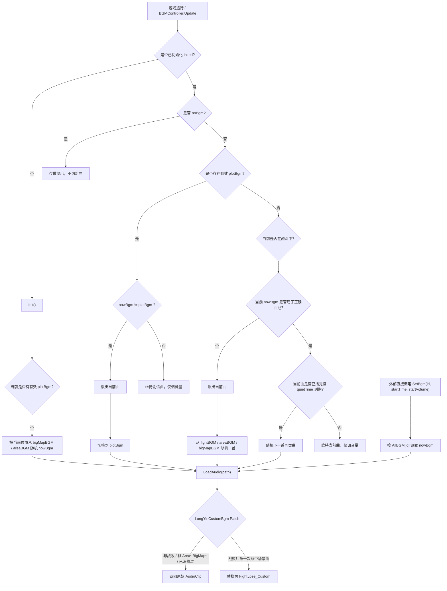

# 《龙胤立志传》自定义 BGM Mod

## 当前版本功能

1. 当前版本支持替换“战败后返回场景时播放的 BGM”。
2. Mod 会在战斗结算时判断玩家是否战败。
3. 如果判定为战败，Mod 会预加载外部音频，并在战败后的第一次 `Area*` / `BigMap*` 场景音乐切换时替换为自定义战败曲。
4. 这次替换只生效一次，后续切歌仍交给游戏原本逻辑处理。

## 安装说明

1. 本 Mod 依赖 MelonLoader。
2. 发布包已经包含完整目录结构，直接解压到游戏根目录即可。发布包不附带战败音频文件，需要自行准备 `FightLose.ogg`（见下文）。
3. 解压后会包含：

   - `Mods\LongYinCustomBgm.dll`
   - `UserData\LongYinCustomBgm\LongYinCustomBgm.cfg`

## 首次启动后生成的目录

1. 首次启动时，如果目录不存在，Mod 会自动创建 `UserData\LongYinCustomBgm` 和 `Audio` 目录。
2. 配置文件路径：`UserData\LongYinCustomBgm\LongYinCustomBgm.cfg`
3. 音频目录路径：`UserData\LongYinCustomBgm\Audio`

## 替换战败音乐的用法

1. 将你自己的音频文件放到：

   `UserData\LongYinCustomBgm\Audio\FightLose.ogg`

2. 默认配置会读取这个路径，并在“玩家战败后切回地图/场景 BGM”时播放它。
3. 如果你想改路径，可以修改 `LongYinCustomBgm.cfg` 里的 `FightLoseFile`。
4. 当前推荐优先使用 `ogg` 文件。
5. 仓库和发布包不附带战败音频，请使用你有权使用的音频文件。

## 配置项说明

1. `Enabled=true`

   是否启用整个 Mod。

2. `ReplaceFightLose=true`

   是否启用战败音乐替换。

3. `VerboseLogging=false`

   是否输出详细日志。默认关闭，只有在排查问题时才建议手动改为 `true`。

4. `FightLoseFile=Audio\FightLose.ogg`

   相对于 `UserData\LongYinCustomBgm` 的音频路径。

## 说明

1. 当前版本不是直接拦截游戏内某个固定的 `FightLose` 曲名。
2. 实际替换时机是：玩家战败后，游戏第一次准备切回场景音乐时，将该场景曲替换为你的自定义战败曲。
3. 若替换未生效，请先确认音频文件存在。文件缺失时，日志会输出 `未找到自定义战败音乐文件` 警告，游戏继续播放原版音乐。仍需排查时，可将 `VerboseLogging` 改为 `true` 查看 MelonLoader 日志。

## 实现流程图

